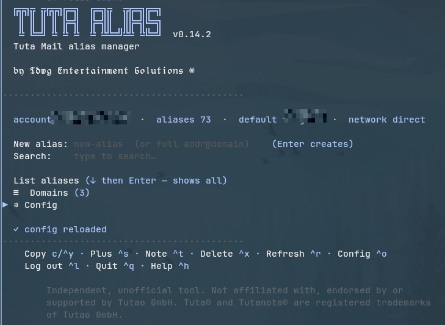

<p align="center">
  
</p>

## Tuta-Alias

A command line client and TUI for managing **Tuta Mail aliases** on your own
custom domains: list them per domain, create and delete them, read the alias
quota, and generate `+` sub-addresses.

Pure Go, no cgo, a single static binary. It speaks Tuta's REST API directly,
including the Argon2id auth-verifier login and TOTP, so it needs no browser and
no Electron app.

## What it looks like

The TUI is the default: `tuta-alias` with no arguments opens it. Everything is
one keystroke away from this screen — create an alias, search, list per domain,
and the whole config.

<p align="center">
  
</p>

## Quick start

```bash
make build && ./bin/tuta-alias install
tuta-alias            # opens the TUI (the install wizard on the very first run)
tuta-alias aliases    # or use it as a plain CLI
tuta-alias doctor     # check install, config, session and tooling
```

Or, without cloning, with the Go toolchain:

```bash
GOPRIVATE=github.com/tdwgm/tuta-alias \
  go install github.com/tdwgm/tuta-alias/cmd/tuta-alias@main
tuta-alias install    # copies the binary to INSTALL_PATH, writes the completions and the config
```

The version is a branch or a commit, not `@latest`: there are no release tags
yet, and `@latest` has nothing to resolve to without one.

The repository is private, so this works only for someone who can read it
(`GOPRIVATE` is what keeps the go command from asking the public module proxy,
and git needs credentials for the repository). `go install` puts the binary in
`$GOBIN`, or `$HOME/go/bin` when that is unset. That is not where `tuta-alias install` puts it: `install` copies
the running binary to `INSTALL_PATH` (default `~/.local/bin/tuta-alias`) and
writes the completion files and the config. So after `go install` you either
run `tuta-alias install` to get all of that, or you keep using the binary where
Go put it (then there are no completions and no config file until you do).

Everything the TUI can set is a key in `~/.config/tuta-alias/tuta-alias.conf`,
and `install` rewrites that file in the current format while keeping your
values.

## What it is not

Reading or sending mail, calendar, contacts and Drive are all out of scope, and
deliberately so: that would mean implementing Tuta's bucket-key crypto, and the
official clients already do it well. This manages addresses.

## CLI

```
tuta-alias                                # opens TUI (prints help when TUI_ENABLED="false")
tuta-alias tui                            # the same, explicitly (works with TUI_ENABLED="false")
tuta-alias login [--email E] [--totp N] [--bw ITEM] [--save] [--saved] [--auto] [-v]
tuta-alias logout
tuta-alias whoami
tuta-alias domains [--json]
tuta-alias aliases [--json] [--domain X]
tuta-alias create  USER@HOST
tuta-alias delete  USER@HOST [--restore]   # aliases: remove, rm
tuta-alias quota   [--json]
tuta-alias dns-check     DOMAIN [--json]   # Tuta's DNS verdict for a custom domain
tuta-alias verify-record DOMAIN            # the t-verify TXT value Tuta expects
tuta-alias plus    BASE@DOMAIN [--note N] [--suffix S]   # local + (sub-)address
tuta-alias plus    list [--json]
tuta-alias serve   [--host H] [--port P] [--print-token] [--rotate-token]
tuta-alias doctor  [--json] [--redact]    # offline checklist: install, config, session, tooling
tuta-alias logs    [-n N] [--path] [--clear] [--redact]   # tail of the log (default 50 lines)
tuta-alias update  [--check]              # rebuild from UPDATE_REF, see Updating
tuta-alias version                        # also --version
tuta-alias options [--json]               # config keys, values, defaults, session status
tuta-alias config  show|path|edit|get KEY|set KEY VALUE|check
tuta-alias vault   set|passwd|rm|status   # the built-in encrypted credential file
tuta-alias install [--quiet]              # TUI wizard, or non-interactive with --quiet
tuta-alias uninstall [--purge]            # --purge: all local state, see below
tuta-alias completion bash|zsh|fish|powershell   # (install writes the ones COMPLETION_* enables)
```

Every setting is reachable three ways and they are the same list: the config
file, the TUI Config screen, and `config get/set`. `config set` validates
before it writes, and `config check` validates the whole file:

```bash
tuta-alias config set THEME green
tuta-alias config set SHOW_ALIASES_FOR '^spam\.example\.com$'
tuta-alias config set PLUS_SUFFIX_LEN abc    # refused: must be a whole number 1-64
tuta-alias config check                      # exit 1 when something is wrong
```

### Plus (sub-)addresses

`plus` generates a `+` sub-address (e.g. `spam+jv5d8@example.com`) from a base
address and saves it **locally only** to
`~/.config/tuta-alias/plus-aliases.json` with an optional note. No alias is
created via the API — sub-addressing routes server-side automatically, so
mail to `spam+anything@example.com` already lands in `spam@example.com`. The random
suffix length is set by `PLUS_SUFFIX_LEN` (default 5). Only `+` addresses
are stored locally; every other address is managed through the Tuta API.

### Doctor and logs

`tuta-alias doctor` prints a checklist of the installation. It is offline and
read-only: it never talks to Tuta, never writes anything and never touches the
system keyring. Each line is marked `✓` (fine), `!` (works, but worth knowing)
or `✗` (wrong), with the command that fixes it where there is one. It checks
the config file (values validated, unknown keys listed), the installed binary
and `$PATH`, the enabled completion files, the session, the credential
backend and its tool, the proxy, the `serve` bind address and API token, the
local `+` address and note stores, the log, the clipboard tool
(`wl-copy`, `pbcopy` or `xclip`), `$EDITOR`, and leftovers from the old
`tuta-cli` name. The exit code is 1 when a check failed (warnings do not
count), so it works in a shell test; `--json` prints the same report as JSON.

`tuta-alias logs` shows the tail of the log file (`-n` sets the number of
lines, default 50), `--path` prints where the file is and `--clear` empties
it. What is written depends on `LOG_LEVEL`: `off`, `error` (the default),
`info` or `debug`. The file is `~/.cache/tuta-alias/tuta-alias.log`
unless `LOG_FILE` names another absolute path, is created with mode 0600 and
is rotated to `.1` at 1 MiB (one old generation).

```bash
tuta-alias doctor || tuta-alias config check
tuta-alias config set LOG_LEVEL debug
tuta-alias logs -n 20
```

## TUI

`tuta-alias` with no arguments opens a bubbletea **dashboard**: the banner +
version, a live info block, a **New alias** field, and a **Search** field. The
full alias list is *not* shown by default: type in Search to filter, or arrow
down to **List aliases** to show the whole set (filtered by `SHOW_ALIASES_FOR`).

Two dotted rules frame the content of every screen: one under the banner
(`COLOR_RULE`) and one above the bottom menu (`COLOR_RULE_FOOTER`), each with
its own colour key.

```
↑/↓        move between New alias, Search and the list · ↓ on the last row enters the bottom menu
Tab        enter the bottom menu (Tab or ↑ leaves it) · ←/→ move inside it
New alias  type a name (uses default domain) or a full addr@domain · Enter creates
Search     type to filter · Enter copies the selected match · ↓ into the list · Esc clears it
↓ to List aliases  → Enter shows all (per SHOW_ALIASES_FOR)
↑/↓ or j/k move in the list · / jumps back to Search
Enter / c  copy the selected address (in the list)
^Y         copy the selected address from any focus
^S         make a + (sub-)address from the selected alias (list focus)
^T         add/edit a local note for the alias (list focus)
^X         delete (disable) the alias, type the full address to confirm (list focus)
^R         refresh
^O         Config (from any screen) · ^L log out · ^Q quit · ^C quit
^H         Help (every screen, including inside a text field)
q          back one level, on Home: quit (not while typing in New alias or Search)
esc        back one level (Config, Plus, Help, Doctor, Logs, Login with a session)
```

Every entry in the bottom menu also runs with Enter, so a shortcut is never
the only way in. On the **Config** screen `^R` reloads from disk, `^T` resets
the Theme group and `^X` asks to uninstall (`y` removes the binary and the
completion files, `Y` also purges). On the **Plus** screen `^R` draws a new
suffix. On the **login form** `^B` / `^K` / `^R` fetch from Bitwarden /
KeePassXC / bw-run, `^L` fills the login saved in the keyring and `^S` toggles
"Save login". On **Doctor** and **Logs** `^R` refreshes, `^L` (Doctor) opens
Logs and `^X` (Logs) clears the log. Help is generated from those same tables
and from the cobra command tree, so it cannot list a key or a command the
program does not have.

Creating an alias in the New alias field copies the new address to the
clipboard; the flash reads `created: <addr> (copied)`.

The first search keystroke per run re-fetches the alias list (again after the
field has been emptied). When `SHOW_ALIASES_FOR` hides addresses, the list
says `showing X of Y · N hidden by SHOW_ALIASES_FOR="…" (search covers all)`.

`^S` opens the **Plus screen** (suffix + note; Enter saves the address
locally and copies it). `^T` opens a **note editor**; notes are stored locally
in `~/.config/tuta-alias/alias-notes.json` and shown beside each alias.

**Live info** sits directly under the banner rule (`LIVE_INFO`, coloured by
`COLOR_LIVE`). `full` shows the account, the alias count, the quota, the
default domain and the network (`direct`, or the proxy with its password
hidden); `compact` shows the account and the alias count; `off` hides the
block. The alias count appears once the list has loaded, and the quota only
when `SHOW_QUOTA="true"` (default off) has fetched it. With `compact` or `off`
and `SHOW_QUOTA` on, Home prints the quota as a line of its own.
**`SHOW_ALIASES_FOR`** filters "List aliases" by a domain or a regexp
(empty = all). **Default domain** is picked from a list of the account's
domains on the Config screen (free text when there is no session). The banner
+ version appear on every screen. `tuta-alias version` prints the version and
the fine print described below; `tuta-alias --version` prints the version.

**Config screen** (`^O`, or the Config row at the bottom of the Home list).
Its rows are generated from the same field table as the config file and
`config get/set`, so no key can be missing from it: the groups Defaults,
Credentials, Network, Serve, Shell completion, Install and Logging, then a
"More" group. Enter on a yes/no row toggles it, on a row with fixed choices
opens a list, on any other row edits it inline. A value is validated before
it is saved, and a refused one shows the reason and changes nothing. Extra
rows sit next to their key: the credential cache status (Enter clears it) under
Cache TTL, and under the serve port the API token (Enter copies it) and
"Rotate API token". The "More" group holds **Theme** (Enter opens a page with
the 17 theme keys and "Reset theme to defaults"; Esc or `q` comes back),
**Doctor** and **Logs**, which show what `tuta-alias doctor` and
`tuta-alias logs` print (scroll with the arrow keys, PgUp/PgDn, Home/End; Esc or
`q` returns to Config). Below them are "Edit config in $EDITOR", "Reload config
from disk" and "Uninstall".

**Help** (`^H`) is generated: the shortcuts of every screen, the CLI commands,
and short notes on aliases versus `+` addresses and on the credential
backends.

Every TUI screen ends with grey fine print under the bottom menu, and
`tuta-alias version` prints it too: the tool is independent and not affiliated
with, endorsed by or supported by Tutao GmbH.

**Auto-login:** with a credential backend configured (`CRED_BACKEND`) and no
valid session, the TUI auto-starts the backend fetch — logging in directly
when a cached/unlocked session exists, or jumping straight to the master-
password prompt otherwise. If a running session expires (HTTP 401/440) the
TUI clears it and re-authenticates the same way.

## Configuration

Configuration is stored at the hardcoded path
`~/.config/tuta-alias/tuta-alias.conf` (shell-style `KEY="value"`, no
`XDG_CONFIG_HOME` override), and generated `+` addresses at
`~/.config/tuta-alias/plus-aliases.json`. `tuta-alias config path` prints the
path, `config show` the file, `config edit` opens it in `$EDITOR`, and
`tuta-alias options` lists every key with its current value and default.

The file, the TUI Config screen and `config get/set` all work on the same list
of keys, which is this table (the install wizard asks about a subset of them).
An empty value is accepted for every key whose default is empty, which is how
a setting is switched off. Booleans are `true` or `false`.

| Key | Default | What it does | Config screen |
|-----|---------|--------------|---------------|
| `DEFAULT_DOMAIN` | (empty) | The domain **New alias** uses when you type a bare name (else the account's first domain). A bare domain such as `example.com`. | Defaults |
| `TUI_ENABLED` | `true` | The TUI is what bare `tuta-alias` opens; `false` prints help instead (`tuta-alias tui` still opens it). | Defaults |
| `PLUS_SUFFIX_LEN` | `5` | Random characters in generated `+` suffixes. A whole number 1-64. | Defaults |
| `SHOW_QUOTA` | `false` | Fetch and show the alias quota on Home. | Defaults |
| `SHOW_ALIASES_FOR` | (empty) | "List aliases" filter: a domain or a regexp (must compile). Empty = all. Search covers all aliases. | Defaults |
| `CRED_BACKEND` | (empty) | Credential backend: `bitwarden`, `bwrun`, `keepassxc`, `keyring` (login saved from the TUI form), `vault` (built-in encrypted file), or empty to type it each time. | Credentials |
| `BW_ITEM` | (empty) | Bitwarden item name or UUID (with `CRED_BACKEND=bitwarden`). | Credentials |
| `BW_RUN_ITEM` | (empty) | bw-run item name (with `CRED_BACKEND=bwrun`). | Credentials |
| `KEEPASS_DB` | (empty) | KeePassXC database path (with `CRED_BACKEND=keepassxc`). | Credentials |
| `KEEPASS_ENTRY` | (empty) | Entry path inside the KeePassXC database. | Credentials |
| `CACHE_TTL` | `8h` | Lifetime of the Bitwarden and KeePassXC credential cache: any Go duration (`8h`, `45m`), `reboot` (cleared by a reboot) or `forever`. The Config screen and the wizard offer `8h`, `1h`, `30m`, `reboot` and `forever`, and keep a duration you set yourself. | Credentials |
| `TUTA_PROXY` | (empty) | Proxy for all Tuta API traffic, e.g. `socks5://127.0.0.1:1055`. Empty = direct. Fail-closed, see below. | Network |
| `SERVE_HOST` | `127.0.0.1` | Bind address for `tuta-alias serve`. An IP address or `localhost`. | Serve |
| `SERVE_PORT` | `8088` | Port for `tuta-alias serve`. 1-65535. | Serve |
| `COMPLETION_BASH` | `true` | Install bash completion to `~/.local/share/bash-completion/completions/tuta-alias`. | Shell completion |
| `COMPLETION_ZSH` | `true` | Install zsh completion to `~/.config/zsh/_tuta-alias`. | Shell completion |
| `COMPLETION_FISH` | `false` | Install fish completion to `~/.config/fish/completions/tuta-alias.fish`. | Shell completion |
| `INSTALL_PATH` | (empty) | Where `install` puts the binary and `uninstall` looks for it. Absolute path; empty = `~/.local/bin/tuta-alias`. | Install |
| `LOG_LEVEL` | `error` | What is written to the log: `off`, `error`, `info` or `debug`. | Logging |
| `AUTO_UPDATE` | `off` | When the TUI starts: `off`, `check` (say when the ref points elsewhere) or `install` (rebuild and replace the binary). | Update |
| `UPDATE_REF` | `main` | The branch or tag an update comes from. | Update |
| `UPDATE_INTERVAL` | `24h` | How often to look for a newer build (a Go duration). | Update |
| `LOG_FILE` | (empty) | Log file, an absolute path. Empty = `~/.cache/tuta-alias/tuta-alias.log`. | Logging |
| `THEME` | `blue` | The accent colour: `blue`, `ocean`, `green`, `red`, `yellow`, `magenta`, `cyan`, `orange` or `purple`. | Theme |
| `COLOR_BANNER` | `accent` | Colour of the banner logo. | Theme |
| `COLOR_HEADER` | `accent` | Colour of headers. | Theme |
| `COLOR_TEXT` | `white` | Colour of body text. | Theme |
| `COLOR_MUTED` | `accent` | Colour of muted text. | Theme |
| `COLOR_SHORTCUT` | `accent` | Colour of menu shortcuts and separators. | Theme |
| `COLOR_SELECTED` | `white` | Colour of the selected menu entry. | Theme |
| `COLOR_RULE` | `grey` | Colour of the dotted line under the banner. | Theme |
| `COLOR_RULE_FOOTER` | `grey` | The dotted line above the bottom menu. | Theme |
| `COLOR_ICON` | `accent` | Markers: the `▶` cursor on a row, and `✓ ! ✗` on the Doctor screen. | Theme |
| `COLOR_BRACKET` | `grey` | The `[ ]` around an action, the `( )` of a choice list, and the `›` on a row that opens a page. | Theme |
| `COLOR_SUBTITLE` | `white` | Colour of the version, description and byline under the logo. | Theme |
| `COLOR_LIVE` | `blue` | Colour of the live info block under the rule. | Theme |
| `BANNER_TEXT` | (empty) | Banner text. Empty = `tuta-alias` in the tool's own logo; anything else is drawn with the font. | Theme |
| `BANNER_FONT` | `logo` | `logo` (the tool's own drawn logo), `block`, `half`, `slant` or `shade`. | Theme |
| `LIVE_INFO` | `full` | Live info under the banner: `full` (account, aliases, quota, default domain, network), `compact` or `off`. | Theme |
| `MENU_EFFECT` | `glitter` | Selected menu entry: `glitter` (a glint sweeps the text) or `none`. | Theme |

The `COLOR_*` keys take `accent` (follow `THEME`), `default` (the terminal's
own colour) or one of `blue`, `ocean`, `green`, `red`, `yellow`, `magenta`,
`cyan`, `orange`, `purple`, `grey`, `light grey`, `white`. The Theme page's
"Reset theme to defaults" (or `^T` on the Config screen) restores exactly the
17 keys from `THEME` down, and nothing else.

The Theme group is the TUI Scaffold theme standard's own list: the same 17 keys
with the standard's defaults, and a test
(`internal/tui/standard_parity_test.go`) checks this project against it key for
key with no deviations left. Two defaults are the application's own and are not
compared: `BANNER_TEXT` and `LIVE_INFO` (whose modes here are `full`, `compact`
and `off`). The accent list is a superset: `ocean` is offered here as well.

Renamed keys keep working. The accent key used to be `COLOR_ACCENT`: it is
still read when `THEME` is absent, and removed from the file on the next save.
`BANNER_FONT="default"`, the old name of `logo`, is still accepted.

Values are checked before they are saved, in the TUI and in `config set`, and
`config check` checks the whole file: it prints one line per bad value and per
key this version does not know, and exits 1 when a value is wrong (or the file
does not exist yet).

## Credentials & saved login

The login can come from Bitwarden, bw-run, KeePassXC, the system keyring, the
built-in encrypted vault, or simply be typed each time (`CRED_BACKEND=""`).
**No password manager is required**, the backends are optional conveniences.
A TOTP code is never stored.

The login form (TUI) has these keys:

```
Ctrl+B / Ctrl+K / Ctrl+R   fetch credentials from Bitwarden / KeePassXC / bw-run
                           (only when that backend is configured; Ctrl+R is
                           bw-run here but refresh on Home)
Ctrl+S                     toggle "Save login" (saved after a successful login)
Ctrl+L                     fill in the saved login, cursor on TOTP (does not submit)
Esc                        on the master-password prompt: log in manually;
                           on the form: quit, or back to Home when logged in
```

`CRED_BACKEND` = `bitwarden` | `bwrun` | `keepassxc` | `keyring` | `vault` | `""`.
`keyring` stores email + password in the Secret Service keyring (service
`tuta-alias`, user `login`) and fills them in on start; the TOTP is never
stored. From the CLI: `tuta-alias login --save` saves after login,
`tuta-alias login --saved` uses the saved login and prompts for the TOTP.
`tuta-alias login --auto` is the non-interactive variant for scripts and
status bars: it uses the credential backend, else the saved keyring login, and
prints one JSON status line. Exit code 0 means logged in, 2 rejected or an
error, 3 the backend needs its master password on stdin, 4 a TOTP is needed,
5 there are no credentials at all.

### The encrypted vault (`CRED_BACKEND="vault"`)

A password manager is not always available: Termux and Android have no Secret
Service, so the `keyring` backend cannot work there and the only alternative
is typing the password on every login. The vault is one file,
`~/.config/tuta-alias/vault.json`, mode 0600, holding one login:

```bash
tuta-alias vault set                      # asks for email, password, passphrase (twice)
tuta-alias config set CRED_BACKEND vault  # start using it
tuta-alias vault status                   # exists? in use? passphrase cached?
tuta-alias vault passwd                   # re-encrypt under a new passphrase
tuta-alias vault rm                       # delete it (asks first; -y skips)
```

In the TUI: tick **Save login** (`^S`) on the login form with
`CRED_BACKEND="vault"`, and after a successful login it asks for a vault
passphrase and writes the file. Esc there skips the save and keeps you logged
in.

How it is encrypted: the passphrase goes through **argon2id** (4 passes,
64 MiB, 16-byte salt, fresh on every write) and the login is sealed with
**XChaCha20-Poly1305** (24-byte nonce, fresh on every write). The KDF
parameters are authenticated along with the payload, so a file edited to ask
for a weaker derivation fails to open instead of quietly using it. Nothing is
appended: every save rewrites the whole file through the same atomic write the
config uses.

**The TOTP secret is not stored, and there is no option to store it.** The
code is asked for at every login, so the file is one factor, not two. The
passphrase is cached under `CACHE_TTL` like the other backends' master
passwords (Config, Cache status, clears it), and `uninstall --purge` removes
both the cache entry and the file.

**HTTP 474** (`InvalidSoftwareVersionError`) means Tuta rejected the client
version. The client then fetches `versionNumber` from `app.tuta.com/index.js`,
caches it in `~/.cache/tuta-alias/client-version` and retries once.

## Proxy (`TUTA_PROXY`)

`TUTA_PROXY="socks5://127.0.0.1:1055"` in `tuta-alias.conf` (or Config →
Network) sends **all** Tuta API traffic through that proxy: CLI, TUI,
`serve`, `login --auto`. Schemes: `socks5://` / `socks5h://` (the proxy
resolves hostnames), `http://`, `https://`; always `host:port`, optional
`user:pass@`. Empty = direct. It is fail-closed: an invalid value stops
network commands with a one-line error (`tuta-alias config edit` and
`config set` still run), and an unreachable proxy fails the request with a
`TUTA_PROXY ... unreachable` error, never a direct fallback. The config file
is the only switch; no environment variable. `doctor` and the live info block
show the proxy with its password hidden.

## `serve` (local REST API)

`tuta-alias serve` binds `SERVE_HOST:SERVE_PORT` from the config file (flags
override, default `127.0.0.1:8088`) and authenticates with a bearer token in
`~/.cache/tuta-alias/api-token`:

```bash
tuta-alias serve --print-token     # the token
tuta-alias serve --rotate-token    # a new one; update your clients
curl -H "Authorization: Bearer $(tuta-alias serve --print-token)" \
     http://127.0.0.1:8088/v1/aliases
curl -X POST -H "Authorization: Bearer $(tuta-alias serve --print-token)" \
     -H "Content-Type: application/json" \
     -d '{"mailAddress":"new@example.com"}' http://127.0.0.1:8088/v1/alias
```

| Route | What it does |
|-------|--------------|
| `GET /v1/healthz` | whether there is a session (`ok`); no token needed (see below) |
| `GET /v1/whoami` | the logged-in account address |
| `GET /v1/domains` | custom domains |
| `GET /v1/aliases[?domain=D]` | aliases grouped by domain, or those of one domain |
| `GET /v1/quota` | alias quota |
| `GET /v1/alias/suggest?domain=D[&hint=H]` | a suggested address on domain D |
| `POST /v1/alias` | create the alias in the JSON body's `mailAddress` |
| `DELETE /v1/alias/ADDRESS[?restore=true]` | disable an alias, or re-enable it with `restore` |

`GET /v1/healthz` answers without a token so a status widget can ask whether
there is a session, but it only returns the account address **with** one.
Requests are refused (403) unless the `Host` header is `localhost`,
`127.0.0.1`, `::1` or the loopback address the server is bound to, which is
what stops a web page reaching the API through DNS rebinding (CORS does not).
Binding to a non-loopback address is taken as "I want this reachable from
elsewhere": the Host check steps aside and the command prints a warning.
Request bodies are limited to 64 KiB and the server has read, write and idle
timeouts. `--rotate-token` deletes the token file and writes a new one; every
client has to be updated, and the Config screen has a "Rotate API token" row
for the same thing.

The token file is created 0600, but one that is already there is whatever made
it: `echo tok > api-token` under a 022 umask, a restore from a backup or a
sync tool leaves it readable by every account on the machine. `serve` takes
group and other access off it before it listens and says so on stderr and in
the log; `doctor` reports the mode without changing it. Tightening the mode
cannot take back a copy somebody already read, so if that is possible, rotate:
`tuta-alias serve --rotate-token`.

## Install and uninstall

`install` writes the config in the current format (keeping your values and
your comments), copies the binary to `INSTALL_PATH` (default
`~/.local/bin/tuta-alias`) via a temp file and a rename, and writes the
completion files whose `COMPLETION_*` key is true (bash, zsh and fish, at the
paths in the table above). It warns when the install directory is not in
`$PATH`. Without `--quiet` it runs a four-step wizard (binary path,
credentials, defaults and serve, completion); the wizard starts from the
config on disk and changes only the keys it asks about, so `TUTA_PROXY`, the
theme and the rest survive a re-run. Bare `tuta-alias` starts the wizard too
when there is no config file yet.

`uninstall` is the same code whether you run it from the shell or from the
Config screen. It removes the binary (at `INSTALL_PATH`, wherever you chose it)
and the bash, zsh and fish completion files, and keeps the config, your saved
`+` addresses, the alias notes, the session, the api-token, the log and the
keyring entries. `--purge` additionally removes the config directory, which
holds `plus-aliases.json` and `alias-notes.json`, so your saved `+` addresses
and notes go with it, plus the session, the api-token, the client-version
cache, the log file and its `.1` rotation (wherever `LOG_FILE` put them), the
update check cache, the keyring entries, and `~/.cache/tuta-alias/` itself
once nothing else is left in it. In the TUI, `y` on the confirmation is the
plain uninstall and `Y` is the purge.

## Updating

There is no release pipeline and the repository is private, so an update is
not a download: it is a rebuild from the ref you point at, using the git
credentials and the Go toolchain your machine already has.

```bash
tuta-alias update --check   # does UPDATE_REF point at a different build?
tuta-alias update           # build it and replace the installed binary
```

`UPDATE_REF` (default `main`) is the branch or tag, `UPDATE_INTERVAL`
(default `24h`) is how often a check is worth making, and `AUTO_UPDATE`
decides what happens when the TUI starts: `off` does nothing, `check` says
when the ref points somewhere else, and `install` rebuilds and replaces the
binary without asking, which is why it is not the default.

The check asks the remote what the ref points at and compares it with the
commit this binary was built from. That answers "is this the build the ref
points at", not "is there a newer one": on a feature branch the ref is
usually behind, and the wording says so rather than talking you into a
downgrade.

A build has to know what it came from for any of this to mean anything, and
it does: the go tool records the revision of the checkout in every binary it
builds, and `go install <module>@<ref>` resolves the ref to a pseudo-version
that carries the commit, so a binary installed by `tuta-alias update` knows
its own commit too. `tuta-alias version` prints it. A build made outside a
git checkout carries no commit, and the updater then says it cannot tell
rather than guessing.

`tuta-alias doctor` reports whether an update is possible at all: it needs
`git` and `go` on PATH and a writable `INSTALL_PATH`.

Rebuilding is what a private repository with no releases allows. Once this is
public and tagged, a release artifact is the better source (no Go toolchain,
no git credentials, no minutes of compiling), and it replaces the build step
alone: the check, the cache and the interval stay as they are.

## Version and releases

The git tag is the version. The go tool derives the module version from the
repository it builds in, and `internal/consts/version.go` reads it back:

| State of the checkout | What `tuta-alias version` says |
| --- | --- |
| at tag `v0.14.0` | `0.14.0 (<commit>)` |
| three commits later | `0.14.1-dev (<commit>)` |
| uncommitted changes | the same with `+dirty` |
| no tag in the history | `0.14.0-dev (<commit>)`, from the changelog |

A pseudo-version's base is the version the commit comes *before*, so
`0.14.1-dev` means "on the way to 0.14.1", not "is 0.14.1". A tarball or a
shallow clone has no tag to read; `consts.fallbackVersion` stands in, and a
test keeps it equal to the newest heading in `CHANGELOG.md`.

**The number is written in one place: the newest `## [x.y.z]` heading in
`CHANGELOG.md`.** The tag follows it, and so does the fallback. Deciding
whether a batch of work is `0.14.1` or `0.15.0` is a judgement about what
changed, and the changelog is where that judgement is already written down.

Both ends of that are automatic. `.githooks/pre-commit` makes sure there is a
version to commit under: when the newest section is already tagged, it opens
the next one in `CHANGELOG.md`, sets `consts.fallbackVersion` to match and
stages both into the commit being made, so a batch of work can never stand
still on a released number. `.githooks/pre-push` then tags that version once
it has no tag yet.

```bash
make hooks     # enables .githooks/pre-commit and .githooks/pre-push
make version   # what this tree builds as, what a push would tag, the last tag
```

The first commit after a release takes a patch bump, because the only hook
that can add a file to a commit is `pre-commit` and it does not get to see the
message being written. Any later commit in the batch raises the number as soon
as the Conventional Commits since the tag add up to more, which is what svu is
asked. `SKIP_VERSION_BUMP=1 git commit` skips it once.

Only the default branch is tagged: a tag on a feature branch points at a
commit that a squash or rebase on merge throws away, and the tag then
outlives the commit it describes. On any other branch the hook prints what
the push would release. git decides what to send before the hook runs, so the
new tag cannot ride along with that push and is pushed on its own.

```
VERSION_TAG_ANY_BRANCH=1 git push   # tag from the branch you are on
SKIP_VERSION_TAG=1 git push         # skip it once
git push --no-verify                # skip every hook
```

Push after a release and nothing is tagged, because the changelog still names
a released version. The hook says so, and says which number to write next:
[svu](https://github.com/caarlos0/svu) (MIT) reads the
[Conventional Commits](https://www.conventionalcommits.org/) since the last
tag (`fix:` a patch, `feat:` a minor, `feat!:` or a `BREAKING CHANGE:` footer
a major) and suggests the number. It is an adviser only, installed with
`go install github.com/caarlos0/svu/v3@latest`, and the hook works without
it. The `tag` job in CI tags the same thing on the merge path, where no local
hook runs.

Releases themselves (tagged binaries, so an update is a download instead of a
rebuild) come when the repository is public. The stamps
`consts.VersionStamp` and `consts.CommitStamp` are there for that build to
state the version outright; nothing has to set them today.

## Contributing: nothing identifying reaches git

This repository has already had to scrub, by hand, a private machine path, a
VPN provider's name, a home directory and a desktop setup out of its own
source, help text and generated config file. A reviewer catching that is luck.
The check that does not depend on luck is
[gitleaks](https://github.com/gitleaks/gitleaks) (MIT), configured in
`.gitleaks.toml`:

```bash
make hooks    # scan the staged diff before every commit (git core.hooksPath)
make scan     # scan the working tree and the whole history
```

On top of gitleaks' own rules for keys, tokens and private keys, this project
adds: an absolute `/home/<name>` or `/Users/<name>` path, a personal cloud
directory (SynologyDrive, Dropbox, OneDrive and the like), an email address
outside the documentation domains, a Tuta session or vault file, the serve
api-token, and a password database. CI runs the same scan over the working
tree and the history on every push, because deleting a committed secret does
not remove it from the clone.

A false positive is fixed with a narrow allowlist entry in `.gitleaks.toml`,
or a `gitleaks:allow` comment at the end of the offending line, never by
turning the rule off.

`tuta-alias doctor --redact` and `tuta-alias logs --redact` do the same job
for output rather than for commits: they remove addresses, bare domains,
paths, the user name and tokens, so a checklist or a log can be pasted into a bug report.

## Build

```
make build         # bin/tuta-alias (host arch)
make build-all     # linux/amd64 + linux/arm64 (arm64 is Termux)
make test          # go test ./...
make test-race     # the same under -race
make fuzz          # fuzz the config parser for a minute
make lint          # go vet + gofmt + golangci-lint (pinned, see .golangci.yml)
make scan          # gitleaks over the tree and the history
make vulns         # govulncheck (pinned) over the call graph
make hooks         # enable the pre-commit and pre-push hooks
make version       # this tree's version, its last tag and the next one
make check         # what CI runs: lint + test + vulns (lint and vulns need
                   #   golangci-lint and govulncheck installed)
make install       # build, then install the way a user would
make clean         # rm -rf bin/
```

CGO is off (`CGO_ENABLED=0`). The binary is fully static and
cross-compilable.

## Project layout

```
├── cmd/tuta-alias/main.go      # cobra root; no-args runs TUI
├── internal/
│   ├── consts/                # protocol constants + AppVersion
│   ├── crypto/                # Argon2id, auth verifier, ParseSessionID
│   ├── typemodel/             # numeric-field-id pack/unpack
│   ├── session/               # JSON I/O
│   ├── atomicfile/            # crash-safe file writes (temp file, fsync, rename)
│   ├── api/                   # HTTP client, errors, client-version (474) refresh
│   ├── login/                 # full login flow
│   ├── services/              # high-level alias ops + quota + suggest
│   ├── config/                # tuta-alias.conf parse/round-trip + field list + validation
│   ├── creds/                 # credential backends: bitwarden, bwrun, keepassxc, keyring (saved login)
│   ├── plusalias/             # local + (sub-)address store + generator
│   ├── notes/                 # local alias notes
│   ├── cliflow/               # CLI command handlers (login, read, mutate, plus, config)
│   ├── selfinstall/           # install/uninstall, shared by the CLI and the TUI wizard
│   ├── doctor/                # the offline checklist behind `doctor` and Config → Doctor
│   ├── logx/                  # the log file and its levels (LOG_LEVEL, LOG_FILE)
│   ├── legacy/                # carries state over from the old tuta-cli name
│   ├── bw/                    # Bitwarden integration (bw-run + keyctl)
│   ├── serve/                 # local REST API
│   └── tui/                   # bubbletea screens (home, login, config, plus, doctor, logs, help, install wizard)
├── Makefile
└── go.mod
```

## Status and protocol

The protocol constants and type-model definitions are reused and ported from the
official open-source Tuta client code in
[`tutao/tutanota`](https://github.com/tutao/tutanota) (GPL-3.0), pinned to a
known-good release. Tuta rejects a stale client version with HTTP 474, which
the client handles at runtime by reading the deployed version and retrying once.

## Licence & attribution

Licensed under **GPL-3.0-only** — see [LICENSE](LICENSE).

- Protocol constants, entity type-model definitions, and authentication flow
  specifications are derived and reused from
  [`tutao/tutanota`](https://github.com/tutao/tutanota), Copyright © Tutao GmbH,
  licensed under the GNU General Public License v3.0.
- `tuta-alias` is an independent third-party tool and is **not** affiliated
  with, endorsed by, or supported by Tutao GmbH. Tuta® is a registered trademark
  of Tutao GmbH.
